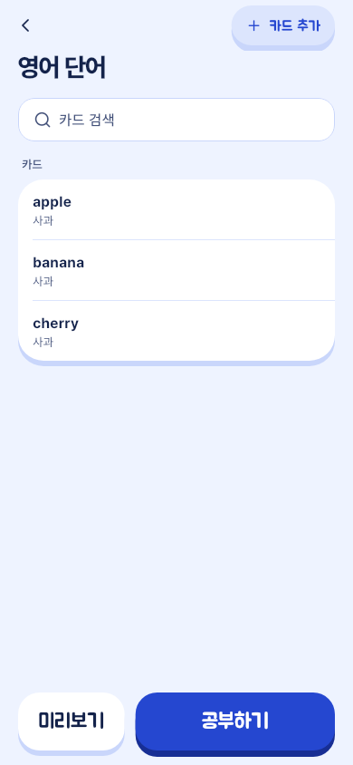
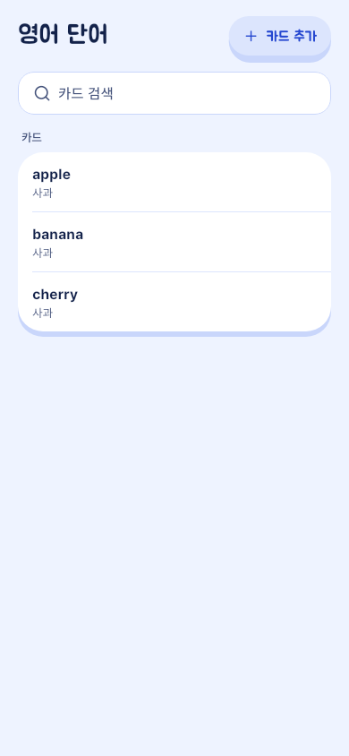
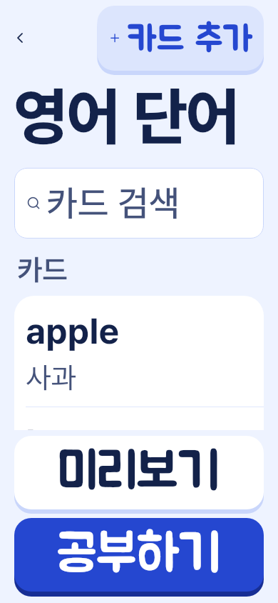
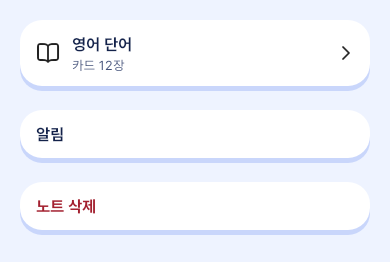
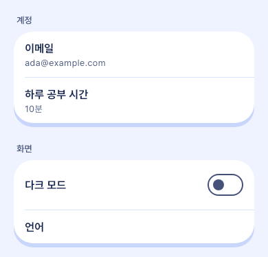
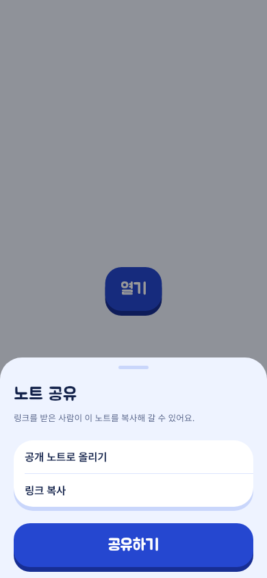
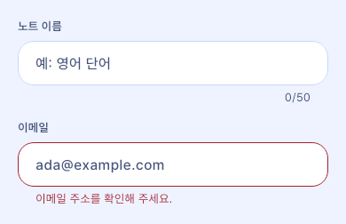

# Design frames

The layouts screens are built from on the phone and the web: each frame's parts in order, its tokens and the component that draws it. A screen names the frame it uses and describes only what is its own.

## Current decisions

Values are [`theme.md`](theme.md)'s tokens and components [`components.md`](components.md)'s. A screen that needs a layout no frame gives proposes one here first.

Each frame's image is drawn from the phone's components in light at 390 wide by `app/test/screenshots/design_shots_test.dart`, written by `make design-shots` and checked by `make test-app` ([`checks.md`](checks.md) §Frame images). The web's table has none, since the phone draws no table.

### Screen skeleton

The frame of a screen the user lands on: the 노트 tab, the deck screen, 설정.

The images show the own action alone: the ⋯ is `ListHeaderActions`, which belongs to `home/`.

1. Header: the title (`deckTitle` for a tab, `deckName` for a name the user wrote), and at its end the screen's own action, `AppButton` tonal at size `header`, then ⋯ holding the other actions (`ListHeaderActions`); where the app has an assistant, adding by hand is "직접 추가" in the ⋯ and the screen has no action of its own ([ADR 0204](../adr/0204-draw-malangi-at-a-screen-s-edge-name-the-note-a-chat-opens-from-attach-photos-to-a-message-and-follow-their-job-from-the-phone.md)). The bar grows to the action's line at a large text size.
2. Search, where the screen lists what a user made: always shown under the header, `AppSize.search` high (`AppSearchField`).
3. Body: groups and rows (§Group and section), `AppSpace.sectionGap` between groups.
4. The primary, where the screen has one: in `BottomActions` at the foot, or inside the card it acts on.

The phone draws it as `ScreenSkeleton` (`app/lib/design/screen_skeleton.dart`), with a slot for each part above: `title` (with `userTitle` for a name the user wrote), `actions`, `search`, `body` as slivers and `bottom`. A tab's first screen (`topLevel`) has no back bar and shares one line between the title and the actions; any other screen has a bar `AppButton.barHeight` high with the back arrow and the actions, and the title under it. The 기록 tab, the 노트 tab, the deck screen, 설정, the 라벨 screen, 둘러보기, a public deck and 새 노트 use it. These keep their own layout, each for a reason the slots cannot hold:

- 홈 (`home_tab.dart`): the day's hero on its sky with the profile button, no title, list or primary of the frame.
- Chat with 말랑이 (`chat_screen.dart`): a header with the character's face, a reversed list that grows from its foot and a composer, not a title over a body.
- Study (`study_screen.dart`), the card preview (`card_preview_screen.dart`), the card editor (`card_editor_screen.dart`) and the spreadsheet import (`spreadsheet_import_screen.dart`): a top bar of their own (a close, the progress and count, or the editor's title and "미리보기") in place of the back bar and title.
- Photo import (`photo_import/`, with the photo viewer): a full-screen flow with a close in its top bar and a bottom bar of its own table.
- The daily-minutes screen (`daily_minutes_sheet.dart`): the picker, a sheet or a screen with its two buttons, whose title the picker draws.
- Sign-in and sign-in by email: shown before the user is signed in.

The web draws it as `ScreenSkeleton` (`web/src/design/screen-skeleton.tsx`) with the same slots but the foot's: `title` (with `userTitle`), `actions`, `search` and the body as children. The shell's `main` holds the gutters, `AppSpace.gutter` below 1024 px, so a slot sets none of its own; the slots are `AppSpace.s16` apart and the body's groups `AppSpace.sectionGap`. The web has no back bar, so a `topLevel` screen is one a menu opens, 기록, 노트 and 설정, and the 노트 page, whose actions make the bar above its name, is not. A tab bar sits at the web's foot, and no web screen has a primary there, so the component has no `bottom` slot until one does; a note's study button stays at the top of its body. These keep their own layout on the web, for the phone's reasons or because the web has no such screen: 홈, the chat with 말랑이 and study, and 새 노트 and the authoring screens, which open over the page as full-screen dialogs (`web-decks.md`).

Horizontal edges are `AppSpace.gutter` throughout. The 노트 tab and the deck screen use it ([ADR 0172](../adr/0172-make-a-note-with-the-choices-of-its-customization-head-the-notes-and-a-note-with-a-tonal-action-and-a-menu-over-an-always-shown-search.md)).

### List row

One row of a list or a group: `AppListRow`.

1. Leading widget, optional, only where [`brand.md`](brand.md) §Icons allows one.
2. Title in `bodyStrong`, `ink` (red for a destructive row).
3. Second line, optional, in `caption`, `muted`, only where the title alone does not say what happens ([`copy.md`](copy.md) §Forms).
4. Trailing widget, optional: a chevron that leads on, a check, a switch, a value.

Inset `AppSpace.s16` at the start and `AppSpace.s12` elsewhere, `AppSpace.s12` between the parts; read as one node. Alone, a row is its own `surface` on the `row` radius over `edgeRow`, `AppSpace.rowGap` below it. A row with a layout of its own (a card row, a skeleton row) is `AppRowSurface` around it.

### Group and section

Rows that share one meaning: a settings section, a note's cards, one 칸 of a card.

1. Section label, optional: `AppSectionLabel`, in `section`, `muted`, read as a heading, inset `AppSpace.s4` with `AppSpace.s8` below it.
2. Group: `AppGroup` (`SliverAppGroup` for a long list), one `surface` on the `group` radius over `edgeCard`; its rows split by a `hairline` 1 px high, indented `AppSpace.s16`, under all but the first. A row inside draws no surface and no gap of its own.

One group per meaning; groups stand `AppSpace.sectionGap` apart. Inside a group a hairline separates the rows, never a border on each field.

### Table

Rows of the same columns an operator compares and pages through: the web admin area's users, notes and plans ([ADR 0181](../adr/0181-list-every-user-in-admin-as-a-paged-table-filtered-by-plan-and-status-with-the-one-chosen-beside-it-and-give-plans-and-admins-a-page-each.md)), drawn by `admin-table.tsx`. The phone has none.

1. Filters, optional, above it: the list's search and native selects, each `search` high in its outline, wrapping.
2. The table: one `surface` on the `group` radius over `edgeCard`; a header row of column names in `section`, `muted`; its rows split by a `hairline`; the row a side panel shows on the ground. A row that opens something is pressed as one.
   - **Alignment**, set per column, its header and its cells alike: a short categorical column drawn as chips, such as a plan or a state, centred; a number, such as a count, aligned to the end in tabular figures; text, such as an email, a name or a date, at the start. A card below 1024 px keeps every value at the start.
3. The pager, optional, under it: "first–last / total" in `caption` and the pages around the current one, the current marked as the menu marks its item.

Below 1024 px the header row goes, and each row is a card of its own, as a row alone is (§List row): a `surface` on the `row` radius over `edgeRow`, `AppSpace.rowGap` apart, its first cell on a line of its own and the others wrapping under it, each naming what it holds before its value. The pager then shows "page / pages" in `caption` and the two arrows alone.

### Sheet and dialog

Every modal on the phone: `AppSheet` opened by `showAppSheet`; the web's dialogs follow the same parts.

1. Drag handle, `AppSize.handle`.
2. Title in `title` (`deckName` when it holds a name the user wrote), named by [`copy.md`](copy.md) §Forms.
3. Body, optional: one or two sentences in `secondary`.
4. Content: rows (on `ground`), a field, a choice.
5. Actions, pinned above the keyboard, full width, the primary last; no cancel.

Insets `AppSpace.gutter` at the sides, `AppSpace.s12` above and `AppSpace.s16` below; the `sheet` radius; a blurred shadow, since a sheet floats. A confirmation is `showAppConfirm`: a question title, the consequence in one sentence, then a cancel and, last, the red `destructiveFinal` button.

### Form field

A field the user types in: `AppTextField`.

1. Label in `section`, `ink2`, once, above the field, starting on its left edge.
2. Field, `AppSize.field` high (`AppSize.search` for a search), its text in `body` inset `AppSpace.s16`, a hint inside.
3. Error in `caption` below, as [`copy.md`](copy.md) §Forms writes it; a counter below where a limit exists.

`AppSpace.s8` between label and field. Label, field and error are read as one.

### Empty and failure state

What a screen shows in place of content it has none of, or could not read.

1. Mascot, where [`brand.md`](brand.md) §Mascot names the moment: one, never beside an error's red.
2. One sentence, [`copy.md`](copy.md) §Forms's empty state or screen's error, wrapped between words.
3. The one action that leads out: an empty state's is the screen's primary ([ADR 0145](../adr/0145-redraw-the-screens-for-the-coral-mascot-rounder-with-one-current-tab-two-chart-colours-and-one-way-out-of-an-empty-state.md)); a read failure's is "다시 시도" (`RetryButton` on the web).

A search with no match is one `muted` line saying to try other words, with no action.

## Rationale

- [ADR 0172](../adr/0172-make-a-note-with-the-choices-of-its-customization-head-the-notes-and-a-note-with-a-tonal-action-and-a-menu-over-an-always-shown-search.md) records the header's tonal action and ⋯ over an always-shown search.
- [ADR 0118](../adr/0118-name-each-concept-once-write-each-role-in-one-form-hold-every-screen-to-one-set-of-visual-details-and-redraw-settings-and-the-deck-screen-by-them.md) records one group of hairline rows per meaning.
- [ADR 0145](../adr/0145-redraw-the-screens-for-the-coral-mascot-rounder-with-one-current-tab-two-chart-colours-and-one-way-out-of-an-empty-state.md) records the shape of an empty state.
- [ADR 0024](../adr/0024-one-voice-and-a-sheet-action-rule.md) records the sheet's action rule.
- The frames are the owner's direction of 2026-11-03 (#647).

## Open questions

None.
